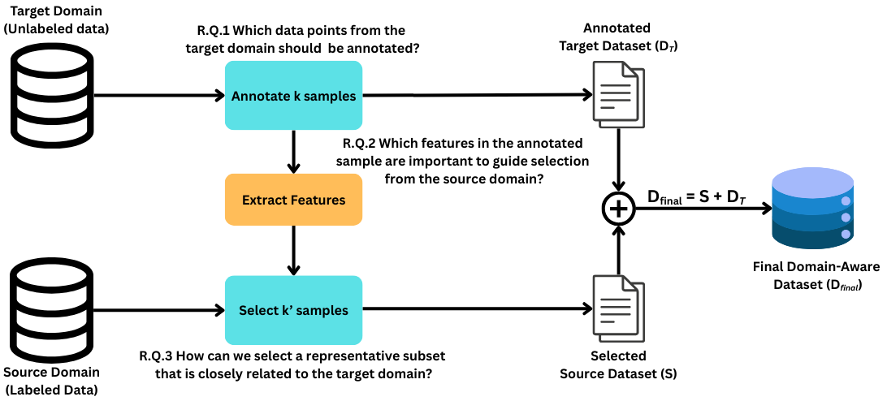
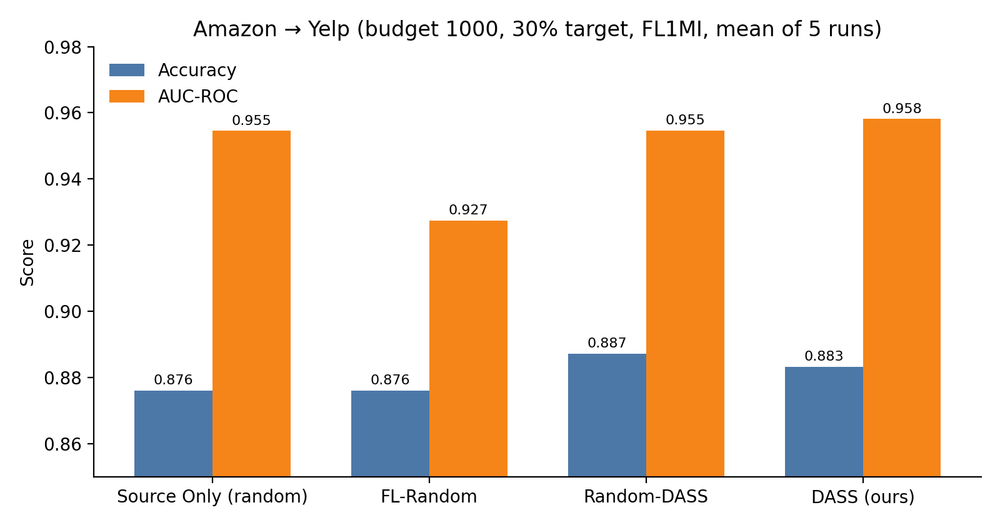

# DASS: Domain-Aware Submodular Selection

**Choose which target-domain examples to label, then which source-domain examples to train on, using submodular optimization.**

DASS is a data-selection framework for low-resource domain adaptation. You have plenty of labeled
data in a *source* domain (e.g. Amazon product reviews), little or no labeled data in a *target* domain
(e.g. Yelp restaurant reviews), and a fixed annotation and training budget. DASS answers two questions:

1. **Which target examples should be annotated?** It picks a diverse, representative subset with a
   **facility-location** function.
2. **Which source examples should be used for training?** It picks source examples that maximize
   **submodular mutual information (SMI)** with the annotated target set, so they are relevant to the
   target while staying diverse.

The model is then fine-tuned on the union of the two selections.

📄 **Paper:** [DASS: Domain-Aware Submodular Optimization for Data Selection](paper/DASS_paper.pdf)
(course project, CSCE 6270, University of North Texas, Spring 2025)



## Results

Amazon reviews → Yelp reviews, binary sentiment. RoBERTa-base was fine-tuned for 3 epochs on 1,000
selected examples (30% from the target domain), and the source selection used FL1MI. Scores are on the
Yelp test set (250 reviews), averaged over 5 runs:

| Method | Target selection | Source selection | Accuracy | F1 | AUC-ROC |
|---|---|---|---|---|---|
| Source Only | none | random | 0.876 | 0.866 | 0.955 |
| FL-Random | facility location | random | 0.876 | 0.861 | 0.927 |
| Random-DASS | random | SMI | **0.887** ± 0.012 | **0.869** ± 0.014 | 0.955 ± 0.004 |
| **DASS (ours)** | facility location | SMI | 0.883 ± 0.018 | 0.866 ± 0.012 | **0.958** ± 0.002 |

<p align="center"></p>

**Takeaways**
- Choosing source data with SMI is what drives the gains. Both SMI variants beat the random-source
  baselines on accuracy, and DASS has the best AUC.
- Facility-location target selection does little on its own (FL-Random ≈ Source Only).
- In single exploratory runs, the FL2MI and GCMI variants did not beat the baselines (see below), so the
  choice of SMI function matters.

The table is generated from the saved metrics with `python scripts/summarize_results.py`.
(The paper reports 0.952 AUC for Random-DASS; recomputing from the saved runs gives 0.955.)

<details>
<summary>Other SMI functions (single runs)</summary>

| SMI | Method | Accuracy | F1 | AUC-ROC |
|---|---|---|---|---|
| FL2MI | Source Only | 0.896 | 0.880 | 0.929 |
| FL2MI | FL-Random | 0.888 | 0.877 | 0.964 |
| FL2MI | Random-DASS | 0.828 | 0.794 | 0.925 |
| FL2MI | DASS | 0.860 | 0.840 | 0.949 |
| GCMI | Source Only | 0.876 | 0.866 | 0.955 |
| GCMI | FL-Random | 0.876 | 0.861 | 0.927 |
| GCMI | Random-DASS | 0.884 | 0.861 | 0.966 |
| GCMI | DASS | 0.852 | 0.820 | 0.950 |

In the FL2MI run the Source Only baseline scores differently from the main table, so these single runs
are not directly comparable with the 5-run FL1MI results.

</details>

## How it works

Given a budget *B* and a target ratio *r*:

| Stage | Picks | Objective |
|---|---|---|
| 1. Target selection | k₁ = r·B target points to annotate | Facility location: maximize Σ<sub>i∈D<sub>T</sub></sub> max<sub>j∈T</sub> s<sub>ij</sub> (coverage of the target distribution) |
| 2. Source selection | k₂ = B − k₁ source points | SMI with the annotated set, e.g. FL1MI: Σ<sub>i∈T</sub> max<sub>j∈S</sub> s<sub>ij</sub> + η Σ<sub>i∈S</sub> max<sub>j∈T</sub> s<sub>ij</sub> |

Similarities *s<sub>ij</sub>* are cosine similarities between `all-MiniLM-L6-v2` sentence embeddings.
Both objectives are maximized with lazy greedy, which has a (1 − 1/e) approximation guarantee for
monotone submodular functions. The implementation uses [submodlib](https://github.com/decile-team/submodlib).

Supported SMI functions for stage 2 (`--source_method`): `fl1mi`, `fl2mi`, `gcmi`, `logdetmi`.
Supported functions for stage 1 (`target_selection_method`): `fl`, `gc`, `logdet`.

## Installation

```bash
git clone https://github.com/twumasimb/DASS.git
cd DASS
python -m venv .venv && source .venv/bin/activate
pip install -r requirements.txt
```

A CUDA GPU is recommended for fine-tuning. Embedding and selection also run on CPU.

## Quick start: use DASS on your own data

```python
from datasets import Dataset
from dass import DASS

# Each dataset needs an `input` (text) column and a `label` column.
source = Dataset.from_dict({"input": source_texts, "label": source_labels})
target = Dataset.from_dict({"input": target_texts, "label": target_labels})

dass = DASS(source=source, target=target, model="all-MiniLM-L6-v2",
            budget=1000, target_ratio=0.3, source_method="fl1mi", source_eta=1.0)

train_set = dass.curate()            # 300 target + 700 source examples, with a `domain` column
dass.generate_statistics("stats/")   # MMD, diversity, and t-SNE/PCA/heatmap plots
```

For a runnable demo on public data (IMDB → SST-2), run `python example.py`. For a step-by-step version
that also fine-tunes a classifier, see [`notebooks/walkthrough.ipynb`](notebooks/walkthrough.ipynb).

## Reproducing the experiments

1. Prepare the data as described in [`data/README.md`](data/README.md).
2. Run the main Amazon → Yelp experiment, which trains and evaluates all four methods:

   ```bash
   ./run.sh                                  # paper settings
   ./run.sh --source_method gcmi --wandb     # extra flags are forwarded to main.py
   ```

3. Run the leave-one-category-out Amazon experiment:

   ```bash
   python main.py --experiment_name Experimental_Results --dataset amazon-subgroup \
       --target_domain Appliances --learning_rate 2e-5
   ```

Run `python main.py --help` to see all options (`--methods`, `--budget`, `--target_ratio`,
`--save_stats`, `--wandb`, and others). Outputs go to `<experiment_name>/<source_method>/<method>_output/`.

## Repository structure

```
├── dass/                       # the library
│   ├── dass.py                 # DASS: stage 1 (facility location) + stage 2 (SMI)
│   ├── random_dass.py          # ablation: random target + SMI source
│   ├── fl_random.py            # ablation: facility-location target + random source
│   ├── random_baseline.py      # baseline: random source only
│   ├── smi.py                  # submodlib wrappers (SubmodSelection, SMI)
│   ├── sentiment_classifier.py # RoBERTa fine-tuning, evaluation, and plots
│   ├── statistics_generator.py # selection statistics (MMD, distances, diversity)
│   ├── plot_utils.py           # t-SNE/PCA, similarity heatmap, domain distribution
│   └── utils.py                # text and image embeddings, MMD, source/target split
├── main.py                     # experiment runner (selection → fine-tuning → evaluation)
├── run.sh                      # paper configuration
├── example.py                  # minimal IMDB → SST-2 selection demo
├── notebooks/walkthrough.ipynb
├── data/                       # dataset build scripts and data instructions
├── results/                    # saved metrics and plots from the paper's runs
│   ├── fl1mi/run{1..5}/<method>_output/results/
│   ├── fl2mi/run1/...
│   └── gcmi/run1/...
├── scripts/summarize_results.py
└── paper/DASS_paper.pdf
```

## Citation

```bibtex
@misc{mensahboateng2025dass,
  title  = {DASS: Domain-Aware Submodular Optimization for Data Selection},
  author = {Mensah-Boateng, Twumasi},
  year   = {2025},
  note   = {Course project, CSCE 6270, University of North Texas}
}
```

## Acknowledgements

The submodular functions come from [submodlib](https://github.com/decile-team/submodlib). The SMI
formulation follows Iyer et al. (2021) and Kothawade et al. (2022).

## License

[MIT](LICENSE)
